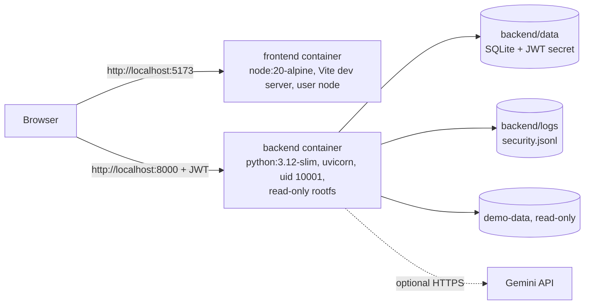
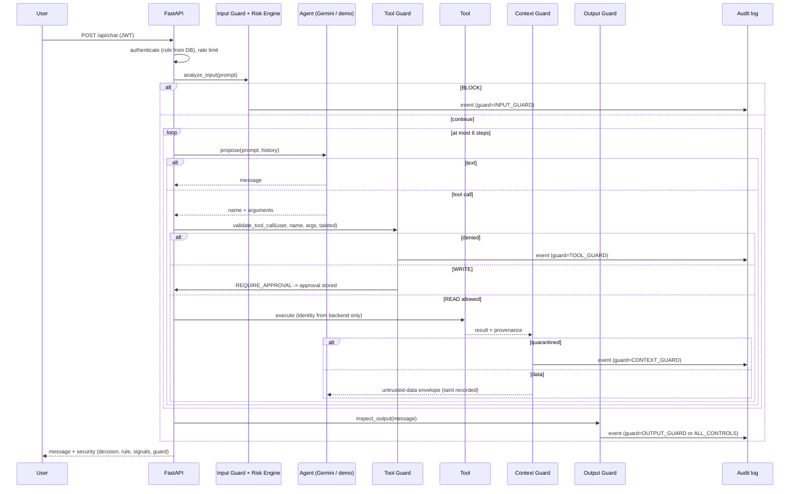

# Architecture

## Deployment

Both ports are bound to `127.0.0.1`. Containers drop all Linux capabilities and set `no-new-privileges`.

## Request lifecycle (`app/services/chat_service.py`)

## Approval lifecycle (`app/services/approval_service.py`)

`PENDING` → (`REVIEWING`, atomic conditional UPDATE) → `APPROVED` | `REJECTED` | `BLOCKED`; or `PENDING` → `EXPIRED`.

On approval: expiry check, argument-hash integrity check, full revalidation as the original requester, exact equality between approved and revalidated arguments, execution, then status change, result and audit event committed in one transaction. The SQLite write lock is held from the claim to the commit, so a concurrent reviewer receives `409`; an exception before commit rolls the claim back to `PENDING`.

## Detection pipeline (`app/security/detection/`)

`normalizer.prepare` → views (`normalized`, `deleet`, `collapsed`, `squeezed`, `decoded:*`) → 8 detectors → `framing.framing_factor` (mention vs. use) → `risk_engine.evaluate`. No LLM is involved. See `docs/risk-model.md`.

## Data model (`app/db/models.py`)

| Table | Purpose |
|---|---|
| `users`, `students`, `professors` | identities and roles (role is authoritative) |
| `courses`, `schedules` | fictional timetable; demo sessions roll forward 7 days at startup |
| `approvals` | tool name, canonical arguments, SHA-256 hash, risk, reason, expiry, reviewer, timestamps, result |
| `security_events` | identity, redacted prompt preview, threat, score, level, decision, deciding guard, rule, signals, correlation id, source, approval id, outcome |

`app/db/migrate.py` adds new nullable columns to existing databases at startup (additive only).

## Gemini integration (`app/llm/`)

- One agent; Gemini receives function declarations filtered by the user's role (`declarations_for`), so the model is never even told about tools the role cannot use.
- Model list: `GEMINI_MODEL` then `GEMINI_FALLBACK_MODELS`, each tried once on 503/5xx/timeout; 429 and client errors fail immediately.
- Process-wide call budget; malformed replies fail closed; at most one function call per turn; at most six turns.
- Without a key, `agent.propose` uses a deterministic French/English intent selector (demo mode) through the same security path.
